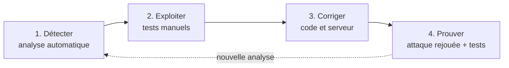
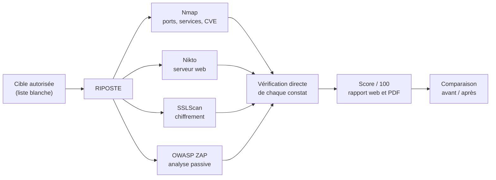

# RIPOSTE

### Plateforme d'audit de sécurité web — de la détection à la correction

**Détecter. Exploiter. Corriger. Prouver.**

RIPOSTE analyse un site web avec quatre outils de référence, vérifie chaque constat pour écarter les faux positifs, puis produit un score et un rapport en français.
Le projet va plus loin qu'un scanner : il embarque son propre terrain d'entraînement, **NetStock Lab**, une boutique e-commerce volontairement vulnérable, pour démontrer le cycle complet d'un audit — trouver les failles, les exploiter, les corriger, puis **prouver** la correction.

---

## En chiffres

| Résultat | Ce que ça mesure |
|---|---|
| **51 → 97 / 100** | Score du serveur web avant et après durcissement |
| **8 / 8** | Failles de la boutique corrigées, chacune prouvée par un test |
| **3 cibles** | Attaquées à la main : NetStock Lab, DVWA, OWASP Juice Shop |
| **88 tests** | Tests automatiques au vert |
| **15 à 40 s** | Par analyse — contre 5 à 7 min pour la première version, basée sur une IA |

---

## Le constat qui a lancé le projet

> Sur NetStock Lab, l'analyse automatique donne **86 / 100 — « Correct »**.
> Pourtant, à la main, la connexion se contourne avec une simple injection SQL, et n'importe quel client peut lire les commandes des autres.
> **Ce site est en réalité critique.**

Ce score trop rassurant n'est pas un bug : il note seulement la **configuration du serveur** (ports, en-têtes, chiffrement, fichiers exposés). Nmap, Nikto, SSLScan et ZAP en mode passif ne voient pas les failles de **logique applicative**.
C'est exactement le piège que RIPOSTE met en évidence : chaque rapport rappelle ce que le score ne couvre pas, et les failles trouvées à la main sont présentées à part, avec leur vraie gravité.

| NetStock Lab (version vulnérable) | Résultat |
|---|---|
| Score de configuration du serveur | 86 / 100 |
| Failles applicatives confirmées à la main | 8 — dont une injection SQL à la connexion et l'accès aux commandes d'un autre client |
| **Verdict réel** | **Critique — à ne pas mettre en ligne** |
D'où l'approche de RIPOSTE : **automatiser ce qui peut l'être, tester à la main ce qui ne peut pas l'être, et prouver chaque correction.**



---

## La plateforme



**Analyse multi-outils** — Nmap (ports, versions, CVE connues), Nikto, SSLScan et OWASP ZAP (exploration et analyse passive), lancés en parallèle.

**Vérification de chaque constat** — chaque résultat est rejoué par une requête directe au site, puis classé : *Confirmé*, *À vérifier*, *Non confirmé* ou *Faux positif probable*. Exemple réel : une méthode DEBUG signalée par Nikto est écartée quand le serveur ne renvoie que sa page normale.

**Contrôles complémentaires** — 47 chemins sensibles (sauvegardes, fichiers de configuration, listage de dossiers), en-têtes de sécurité, cookies, certificat TLS (auto-signé, expiré, mauvais nom), HSTS, redirection HTTP → HTTPS.

**Lecture du contexte réel** — sur la machine hôte, l'adresse d'écoute de chaque port est lue : un service accessible uniquement en local ne pénalise pas le score.

**Score expliqué** — barème affiché (Élevée −20, Moyenne −8, Faible −3) et périmètre clair : le rapport indique aussi **ce qu'il ne teste pas**.

**Comparaison avant / après** — écart de score et statut de chaque constat : *Corrigé*, *Atténué*, *Plus vérifiable*, *Nouveau*, *Aggravé*, *Inchangé*.

**Rapports** — page web et PDF en français, avec preuves, recommandations et références OWASP.

**Garde-fous** — liste blanche de cibles et confirmation d'autorisation obligatoire avant toute analyse.

---

## Le laboratoire : NetStock Lab

Une boutique de matériel réseau fictif (PHP, MariaDB, Apache), écrite pour servir de cible réaliste. Elle n'écoute que sur `127.0.0.1`.
Deux autres cibles de référence tournent à côté dans Docker, elles aussi en local : **DVWA** et **OWASP Juice Shop**.

<details>
<summary><strong>Les 8 failles de NetStock Lab, leur démonstration et leur correction</strong></summary>

| Faille | Démonstration | Correction |
|---|---|---|
| Injection SQL (connexion) | Connexion au compte d'Alice **sans son mot de passe** | Requête préparée |
| Erreur SQL affichée | Erreur de base de données visible par le visiteur | Message générique |
| XSS réfléchi (recherche) | Script exécuté dans le navigateur | Échappement de l'affichage |
| Prix envoyé par le navigateur | Point d'accès payé **0,01 €** au lieu de 89,90 € | Prix relu dans la base |
| Quantité négative | Total du panier qui diminue | Quantité minimale de 1 |
| Code promo réutilisable | Remise appliquée plusieurs fois | Un seul usage par panier |
| Commande d'un autre client (IDOR) | Commande de Bob affichée à Alice | Contrôle du propriétaire |
| Mots de passe en MD5 sans sel | Empreintes faciles à casser | Hachage bcrypt |

En plus : jetons anti-CSRF, en-têtes de sécurité (CSP, X-Frame-Options…), cookie de session HttpOnly et SameSite, nouvel identifiant de session à la connexion.

</details>

---

## Études de cas

### 1. Durcissement d'un serveur web — 51 → 97 / 100

En-têtes de sécurité, version du serveur masquée, méthode TRACE désactivée, listage des dossiers coupé, HTTPS en TLS 1.2 / 1.3 avec HSTS et redirection, mise à jour d'Apache.
**Bilan de la comparaison : 7 constats corrigés, 1 devenu invérifiable, 1 nouveau attendu** (certificat auto-signé, normal en laboratoire).

### 2. NetStock Lab — attaquer, corriger, prouver

- **Avant :** 4 failles exploitées à la main (injection SQL, XSS, prix, IDOR). L'analyse automatique affiche pourtant 86 / 100 : le score ne voit que le serveur, d'où le verdict « critique » posé à la main.
- **Après :** les mêmes attaques échouent. Avec ZAP, le score passe de **80 à 91 / 100** (jetons anti-CSRF et cookie protégé désormais détectés).
- **Preuve :** les tests qui démontraient chaque faille ont été inversés — ils vérifient maintenant que chaque attaque échoue.

### 3. Cibles de référence

- **DVWA** (niveau Low) : injection SQL exposant les 5 comptes, XSS réfléchi.
- **OWASP Juice Shop** : connexion administrateur par injection SQL — défi officiel « Login Admin » validé.

---

## Qualité

**88 tests automatiques** (pytest) : lecture des sorties d'outils, vérification des constats, calcul du score, comparaison, génération du PDF, contrôles TLS face à un vrai serveur local, et boutique lancée dans un serveur PHP jetable pour prouver chaque faille et chaque correction.

---

## Démarrage rapide

Prérequis : Linux, Python 3, Nmap, Nikto, SSLScan (OWASP ZAP en option).

```bash
cd scanner
pip install -r requirements.txt

# Lancer la plateforme, puis ouvrir http://127.0.0.1:5001
IA_ACTIVE=0 PORT_ECOUTE=5001 python3 app.py

# Lancer les tests
python3 -m pytest
```

Laboratoire NetStock Lab : `sudo sh lab/boutique/installer-dans-la-vm.sh` (voir `lab/boutique/README.md`).

---

## Structure du dépôt

```
.
├── scanner/          Plateforme d'audit : code, modèles de rapport, 88 tests
├── lab/boutique/     NetStock Lab, version corrigée (version vulnérable : branche v3-s3-boutique)
├── docs/             Rapport de projet et captures avant / après
└── archive-v1/       Première version du projet, conservée pour l'historique
```

---

## Évolution

| Version | Étape |
|---|---|
| **V1** | Plateforme basée sur une IA — 5 à 7 min par analyse (`archive-v1/`) |
| **V2** | Vrais outils d'audit (Nmap, Nikto, SSLScan) et vérification directe des constats |
| **V3** | Contrôles complémentaires, ZAP, HTTPS, comparaison avant / après, NetStock Lab, 88 tests |

## Feuille de route

- ZAP en mode actif sur le laboratoire
- Tests d'interception avec Burp Suite
- Intégration continue (GitHub Actions) : tests lancés à chaque envoi
- Rapport de projet complet en PDF
- Vidéo de démonstration

---

## Cadre éthique

Toutes les analyses et attaques présentées visent des cibles contrôlées (machine virtuelle, `127.0.0.1`).
La plateforme refuse toute cible hors liste blanche et exige une confirmation d'autorisation.
**Ne jamais analyser un système sans autorisation écrite de son propriétaire.**

---

## Auteur

**Youcef Fettal** — élève ingénieur à l'ESIEA, en recherche d'une **alternance de 2 ans en cybersécurité et réseaux** à partir de septembre 2027.
